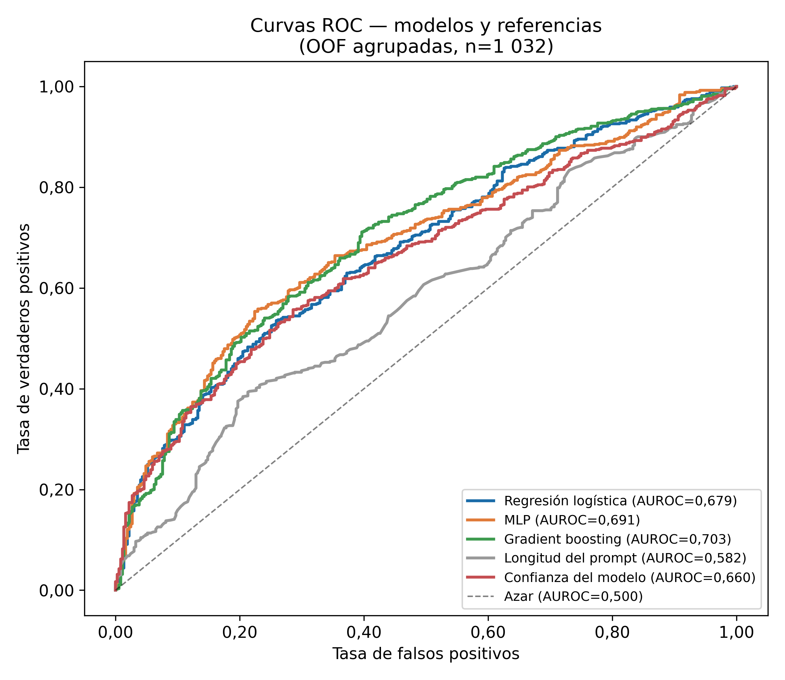

# Detección temprana de errores en la generación de consultas SQL mediante el análisis de activaciones internas del modelo de lenguaje Qwen2.5-Coder-3B

Trabajo de titulación — Maestría en Inteligencia de Negocios y Ciencia de Datos, Universidad de Las Américas (UDLA).
Autor: René Novillo.

Este repositorio contiene el código, los datos derivados, los resultados y la auditoría manual que respaldan el trabajo. Todo lo que aparece en las tablas y figuras se puede regenerar con los scripts incluidos (ver [Reproducción](#reproducción)).

## Pregunta de investigación

Cuando un modelo de lenguaje traduce una pregunta en lenguaje natural a SQL, la métrica habitual (que la consulta se ejecute) no distingue entre una consulta correcta y una que se ejecuta pero devuelve un resultado equivocado (*error silencioso*). Verificar cada consulta con revisión humana no escala.

La pregunta es si las **activaciones internas del modelo, leídas antes de que genere la primera palabra de la respuesta, contienen una señal que anticipe si el SQL resultante será incorrecto**, y qué tan útil es esa señal frente a referencias sencillas (longitud del prompt, confianza del propio modelo).

## Diseño del estudio

**Corpus.** 1 034 preguntas en español de la partición de desarrollo de MultiSpider (variante `with_english_value`), alineadas índice a índice con Spider: cada pregunta conserva la consulta SQL de referencia y la base de datos de Spider (20 bases). Dificultad oficial de Spider: 248 fáciles, 446 medias, 174 difíciles, 166 extra difíciles.

**Modelo.** Qwen2.5-Coder-3B-Instruct en FP16 (sin cuantizar), el mayor que cabe completo en 8 GB de VRAM (RTX 4060 Laptop). Generación determinista (sin muestreo), máximo 200 tokens.

**Activaciones.** Para cada pregunta se guarda el estado oculto del último token del prompt en cada una de las 37 salidas de capa (embeddings más 36 bloques), de dimensión 2 048, en FP16. Se leen antes de generar, de modo que la señal no depende del SQL producido.

**Etiquetas.** Se ejecuta la consulta generada y la de referencia contra las bases SQLite (solo lectura, tiempo límite de 30 s) y se comparan los resultados: *correcta*, *silenciosa* (se ejecuta con resultado distinto) o *sintáctica* (error de ejecución). La comparación respeta `ORDER BY` y tolera la permutación de columnas (verificador v2). Quedan 1 032 preguntas válidas (2 se excluyen porque su consulta de referencia falla): 661 correctas, 232 silenciosas y 139 sintácticas (acierto 64,1 %).

**Validación.** Validación cruzada externa de 5 pliegues agrupada por base de datos (`StratifiedGroupKFold`, semilla 42), de modo que ninguna base aparece a la vez en entrenamiento y prueba. La capa y los hiperparámetros se eligen con validación interna de 4 pliegues dentro de cada entrenamiento. Las probabilidades se calibran con Platt.

**Modelos sobre las activaciones.** Regresión logística L2 (la capa elegida por esta se reutiliza en los demás), perceptrón multicapa y *gradient boosting*. El modelo operativo se fijó con una regla declarada de antemano: *gradient boosting* si supera a la regresión logística con intervalo de confianza completamente por encima de cero.

**Referencias.** Longitud del prompt en tokens, confianza del modelo (media del log-probabilidad de los tokens generados) y, solo de forma descriptiva, la dificultad oficial de Spider.

**Análisis.** (a) comparación de modelos y referencias con AUROC, Brier, calibración e intervalos bootstrap; (b) desempeño frente al error silencioso; (c) curva de aprendizaje; (d) robustez a ruido en las etiquetas, uniforme y concentrado en errores silenciosos; sensibilidad por bases de datos (bootstrap de bases completas); y auditoría manual de 50 errores silenciosos.

## Resultados principales

AUROC con predicciones fuera de muestra agrupadas (n = 1 032) e intervalo bootstrap de 95 % ([`resultados/tablas/tabla_a_modelos.csv`](resultados/tablas/tabla_a_modelos.csv)):

| Detector | AUROC | IC 95 % |
|---|---|---|
| Gradient boosting (modelo operativo) | 0,703 | [0,669; 0,737] |
| Perceptrón multicapa | 0,691 | [0,657; 0,723] |
| Regresión logística L2 | 0,679 | [0,645; 0,711] |
| Confianza del modelo | 0,660 | [0,627; 0,694] |
| Longitud del prompt | 0,582 | [0,547; 0,619] |

- El modelo operativo supera a la longitud del prompt en +0,121 [0,080; 0,162]. Frente a la confianza del modelo la ventaja es +0,043 [−0,004; 0,089]: no se puede descartar que sea nula.
- La señal está en las capas medias y altas: el AUROC por capa sube de 0,59 en la capa 1 hasta cerca de 0,73 entre las capas 24 y 28 ([`fig_a_perfil_capas.png`](resultados/figuras/fig_a_perfil_capas.png)).
- Frente al error silencioso, que es el caso difícil, el AUROC del modelo operativo es 0,678 [0,638; 0,718] (correctas frente a silenciosas); frente al error sintáctico es 0,745.
- Con más ejemplos de entrenamiento el AUROC sigue subiendo: 0,641 con 100, 0,664 con 200, 0,685 con 400 y 0,706 con todos.
- Con etiquetas de entrenamiento ruidosas el AUROC baja de forma gradual (0,691 con 10 %, 0,675 con 30 % de ruido uniforme) y se mantiene por encima de la longitud del prompt en todos los niveles probados.



### Limitaciones

- La señal es moderada (AUROC ≈ 0,70), no alta.
- Las preguntas de una misma base no son independientes y solo hay 20 bases. Al remuestrear bases completas los intervalos se ensanchan mucho: la diferencia con la longitud pasa a [0,005; 0,217] y las demás diferencias incluyen el cero ([`tabla_sensibilidad_bases.csv`](resultados/tablas/tabla_sensibilidad_bases.csv)). El AUROC por pliegue varía entre 0,53 y 0,76.
- Un solo modelo, un solo benchmark y una sola partición.
- Parte de las etiquetas de error silencioso no son atribuibles al modelo. En la auditoría manual de 50 casos: 37 errores reales, 7 consultas de referencia defectuosas, 3 traducciones ambiguas y 3 ambiguos; es decir, 13 de 50 (26 %) no se pueden atribuir con certeza al modelo. El corpus no se re-etiquetó a partir de la auditoría.

## Estructura del repositorio

```
scripts/       Pipeline completo, numerado en orden de ejecución
data/          meta_es.csv (etiquetas y salidas del modelo), folds.csv (pliegues)
resultados/    oof_predicciones.csv, tablas/ y figuras/
auditoria/     Auditoría manual de 50 errores silenciosos
logs/          Registros de cada etapa (entorno, etiquetado, modelado, análisis)
externo/       Aquí se colocan Spider, MultiSpider y el modelo (no incluidos)
```

| Script | Función |
|---|---|
| `00_verificar_entorno.py` | Versiones, CUDA y rutas |
| `01_preparar_corpus.py` | Alinea MultiSpider con Spider y calcula dificultad |
| `02_extraer_y_generar.py` | Extrae activaciones y genera el SQL (GPU) |
| `03_etiquetar.py`, `03b_reetiquetar_permutacion.py` | Etiquetado por ejecución (v1 y v2) |
| `04_consolidar_y_verificar.py` | Consolida lotes y verifica |
| `05_folds.py` | Pliegues agrupados por base |
| `06_modelado.py` | Entrenamiento y predicciones fuera de muestra |
| `07` a `10c` | Análisis (a), (b), (c) y (d) |
| `12_figuras_y_tablas.py`, `13_sensibilidad_bases.py` | Figuras y sensibilidad por bases |

## Reproducción

Requiere Python 3.10 a 3.13 (PyTorch no publica ruedas con CUDA para versiones más nuevas). Las versiones validadas están en [`requirements.txt`](requirements.txt).

**Nivel 1: tablas y figuras, sin GPU.** Con `data/` y `resultados/oof_predicciones.csv` incluidos basta con:

```
python scripts/07_analisis_a.py
python scripts/08_analisis_b.py
python scripts/10c_criterios_ruido.py
python scripts/13_sensibilidad_bases.py
python scripts/12_figuras_y_tablas.py
```

Las tablas regeneradas coinciden con las publicadas (comprobado sobre una copia limpia del repositorio).

**Nivel 2: reentrenar los modelos.** Requiere las activaciones (`data/acts_es.npy`, 157 MB, no incluidas por superar el límite de archivo de GitHub; se generan en el nivel 3). Ejecutar `05` (pliegues), `06` (modelado), `07`, `08`, `09`, `10`, `10b`, `10c`, `12` y `13`.

**Nivel 3: todo desde cero.** Descargar los insumos en `externo/` con esta estructura (o apuntar la variable de entorno `TESIS_EXTERNO` a otra carpeta):

```
externo/spider_data/              dev.json, tables.json, database/   (Spider 1.0)
externo/multispider/dataset/multispider/with_english_value/   dev_es.json, tables_es.json   (MultiSpider)
externo/qwen2.5-coder-3b/         pesos de Qwen2.5-Coder-3B-Instruct
```

Luego ejecutar en orden `00`, `01`, `02` (GPU), `03`, `03b`, `04` y continuar con el nivel 2. Los lotes de extracción se guardan de a 50 preguntas y la corrida se puede reanudar.

## Datos, auditoría y licencias

- **Código** (`scripts/`): licencia MIT ([`LICENSE`](LICENSE)). `scripts/hardness.py` es un puerto de `evaluation.py` de Spider (Apache-2.0).
- **Datos y resultados** (`data/`, `resultados/`, `auditoria/`): CC BY-SA 4.0, porque incorporan las consultas SQL de referencia de Spider, publicado con esa licencia.
- **No se incluyen** el texto de las preguntas de MultiSpider (su repositorio no declara una licencia explícita), las activaciones, las bases SQLite de Spider ni los pesos del modelo. `data/meta_es.csv` se identifica con `qid` e `idx` (índice en la partición de desarrollo) y se puede unir al texto original una vez descargado MultiSpider.
- **Excepción:** la auditoría manual cita las 50 preguntas auditadas, junto con la pregunta original de Spider, para que cada categoría pueda juzgarse.
- **Modelo:** Qwen2.5-Coder-3B-Instruct se usa bajo la *Qwen Research License* (uso no comercial, investigación y evaluación). Ver [`NOTICE.md`](NOTICE.md).

La auditoría ([`auditoria/auditoria_silenciosos_final.xlsx`](auditoria/auditoria_silenciosos_final.xlsx)) recoge 50 errores silenciosos elegidos al azar (semilla 42). Los clasificaron de forma independiente el autor y un modelo de lenguaje con el mismo protocolo, y las discrepancias se resolvieron por consenso caso a caso. La concordancia inicial fue de 58 % por categoría (κ = 0,19) y 64 % binaria (κ = 0,20).

## Notas de seguridad

El verificador ejecuta SQL generado por el modelo. Por eso abre cada base en modo solo lectura, corta cada consulta a los 30 s y bloquea `ATTACH`, `DETACH` y `PRAGMA` mediante un autorizador de SQLite: el modo solo lectura no impide que `ATTACH` cree archivos en disco. Re-etiquetar las 1 034 consultas con el verificador así reforzado reproduce exactamente las etiquetas publicadas.

Las versiones validadas de `accelerate` (1.14.0) y `torch` (2.11.0) tienen avisos públicos: CVE-2026-69112 (lectura de archivos con índices de checkpoint manipulados, sin versión corregida) y CVE-2025-3000 (`torch.jit.script`, corregido en 2.13.0). El pipeline no usa `torch.jit`, y solo carga los pesos oficiales del modelo desde una carpeta local. Descargue los pesos únicamente del repositorio oficial de Qwen.

## Referencias

- Yu, T. et al. (2018). *Spider: A Large-Scale Human-Labeled Dataset for Complex and Cross-Domain Semantic Parsing and Text-to-SQL Task*. EMNLP 2018. arXiv:1809.08887.
- Dou, L. et al. (2023). *MultiSpider: Towards Benchmarking Multilingual Text-to-SQL Semantic Parsing*. AAAI 2023.
- Hui, B. et al. (2024). *Qwen2.5-Coder Technical Report*. arXiv:2409.12186.
